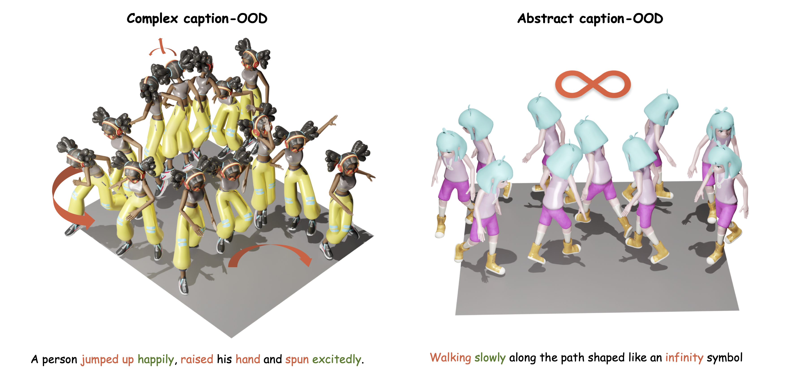
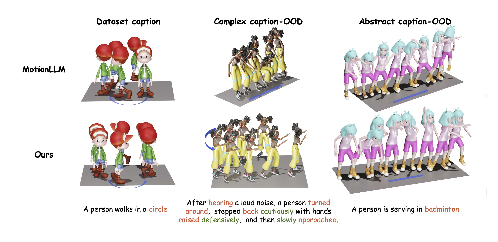

<div align="center">   
  
# Motion-R1: Enhancing Motion Generation with Decomposed Chain-of-Thought and RL Binding

## ICLR 2026

</div>

## [Project Page](https://motion-r1.github.io/) | [Paper](https://arxiv.org/abs/2506.10353)

# News
- **[2025/6/12]** Repository Initialization.

## Abstract
Text-to-Motion generation has become a fundamental task in human-machine interaction, enabling the synthesis of realistic human motions from natural language descriptions. Although recent advances in large language models and reinforcement learning have contributed to high-quality motion generation, two major challenges remain. Existing approaches often fail to capture the temporal and causal complexities inherent in natural language, leading to oversimplified or incoherent motions. Additionally, RL-based methods are frequently overly complex, hindering their scalability and adaptability across various motion generation tasks. To address these challenges, we propose Motion-R1, a novel framework that combines decomposed Chain-of-Thought reasoning with reinforcement learning to enhance both the quality and interpretability of generated motions. Specifically, we introduce the Decomposed CoT Data Engine, which leverages an automated pipeline to synthesize high-quality reasoning data, allowing the model to better capture the temporal dependencies and causal relationships of human motion. We also propose RL Binding, a reinforcement learning strategy that incorporates multi-modal text-motion alignment into the RL reward function, guiding the model to produce motions that are both semantically accurate and motionally realistic. Extensive experiments across benchmark datasets demonstrate that Motion-R1 achieves state-of-the-art performance, with a 3.5% improvement in MM-Dist on HumanML3D and improvements in R-Precision and FID on KIT-ML and BABEL, surpassing existing methods across key metrics and highlighting its superior capability in handling complex motion generation tasks.


## Method Overview

The framework consists of two stages: (1) MotionCoT Data Engine uses DeepSeek-R1 to generate CoT-style motion planning traces in `<think>`, `<output>`, and `<Motion>` format to fine-tune an LLM; (2) GRPO-based training ranks grouped outputs by format, motion, and semantic rewards to optimize the LLM via reinforcement learning.


## Comparisons
We compare Motion-R1 against baselines such as MoMask and MotionLLM. As shown in Left of Figure, Motion-R1 produces smooth, well-structured sequences for simple and multi-step instructions. To evaluate generalization beyond the training distribution, we present qualitative comparisons under two types of out-of-distribution captions, as shown in middle and right of Figure.



## BibTeX

```bibtex
@misc{ouyang2025motionr1chainofthoughtreasoningreinforcement,
      title={Motion-R1: Chain-of-Thought Reasoning and Reinforcement Learning for Human Motion Generation}, 
      author={Runqi Ouyang and Haoyun Li and Zhenyuan Zhang and Xiaofeng Wang and Zheng Zhu and Guan Huang and Xingang Wang},
      year={2025},
      eprint={2506.10353},
      archivePrefix={arXiv},
      primaryClass={cs.CV},
      url={https://arxiv.org/abs/2506.10353}, 
}
